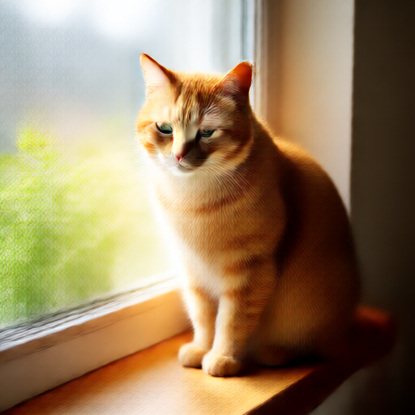

# 2026-10-13～14 生图实验

本目录保留实际请求和结果，不在项目整理时重跑 GPU 测试。日志副本仅移除终端颜色控制码与行尾空格，便于 Git 阅读；原始日志留在原位置。

## 目录解释

- `baseline/`：最初的 Anima BF16 / Krea FP8 请求及 Krea 切换 Q2 前的 UI 工作流。
- `results/`：ComfyUI 返回的历史记录与 prompt ID；仅有 ID 不代表成功，须看对应 history 的 `status`。
- `logs/`：初次崩溃日志，以及项目整理时复制的 `comfyui.stdout.log` / `comfyui.stderr.log` 快照。
- `inspection/`：一个未采用的在线 Anima Q5 文件的头部分析；不是本机 Q5 转换结果。

## 成功结果

| 测试 | Prompt ID | 实际参数 | 整次耗时 |
| --- | --- | --- | --- |
| Anima BF16 | `736addf0-57dd-4e1f-9048-7c509671a173` | 512×512，28 步，CFG 4，euler / sgm_uniform | 1588.033 秒 |
| Anima Q5_0 | `af48f504-88f7-4a99-b655-032473d6414f` | 512×512，4 步，CFG 4，euler / sgm_uniform | 127.10 秒 |
| Krea Q2_K | `e54611ba-958f-4254-af45-7eb21099743e` | 512×512，2 步，CFG 1，euler / simple | 453.75 秒 |

总耗时包括加载、文本编码、采样与解码；结果 JSON 时间戳与后端日志的计时边界略有差异。量化短测固定 seed 为 20261013。

- Anima Q5 主模型完整进入 GPU，约 1978.68MiB；4 步采样约 100.84 秒，图像细节明显不足。28 步约 12 分钟只是当时根据速率作的估计，没有执行量化版本 28 步长测。
- Krea Q2 的 2 步采样约 345.05 秒，8 步长测没有执行。
- Anima BF16 与 Q5 对比同时改变了计算精度、编码设备、采样步数，并受温度/频率影响；不是只改变权重量化精度的严格对照实验。
- 最初 Krea FP8 和部分编码设备测试曾被中断，`krea2-run-id.txt` 不对应一张成功交付的图片。

## 图片

### Anima Q5，4 步短测

### Krea Q2，2 步短测

### Anima BF16，28 步历史基线

## 未采用的在线 Q5 文件

`inspection/anima-q5-tensors.json` 来自 [vanes430/Anima-2.9B-GGUF](https://huggingface.co/vanes430/Anima-2.9B-GGUF) 的部分文件头。会话中只读取约 1 MiB 头部，发现文件大小与若干矩阵逻辑维度和源 Anima 2.9B 不一致，因此没有下载完整文件或用于推理。

`inspection/anima-q5-header.bin` 在本地项目保留，因属于模型二进制片段而被 Git 忽略。实际使用的 Q5_0 来自 `scripts/quantization/convert_anima_q5.py` 的本机转换。
